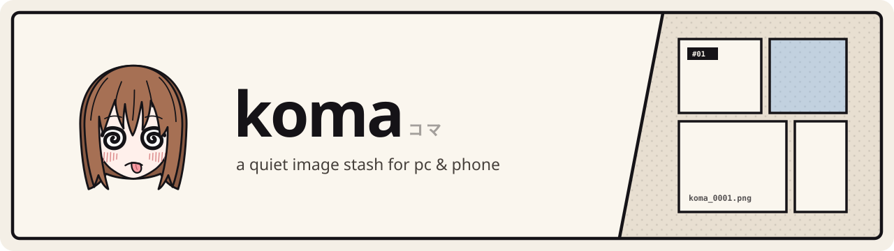
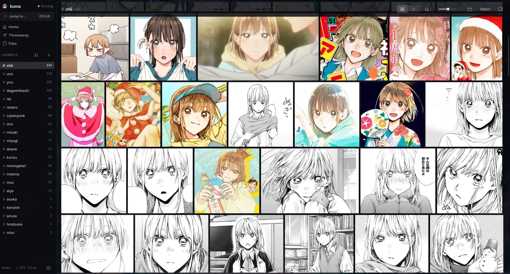
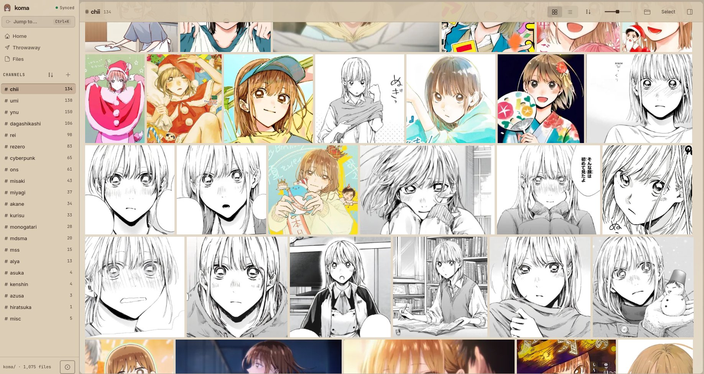
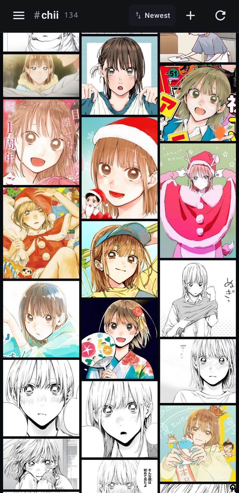
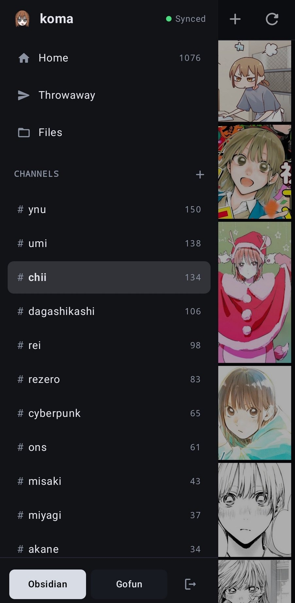
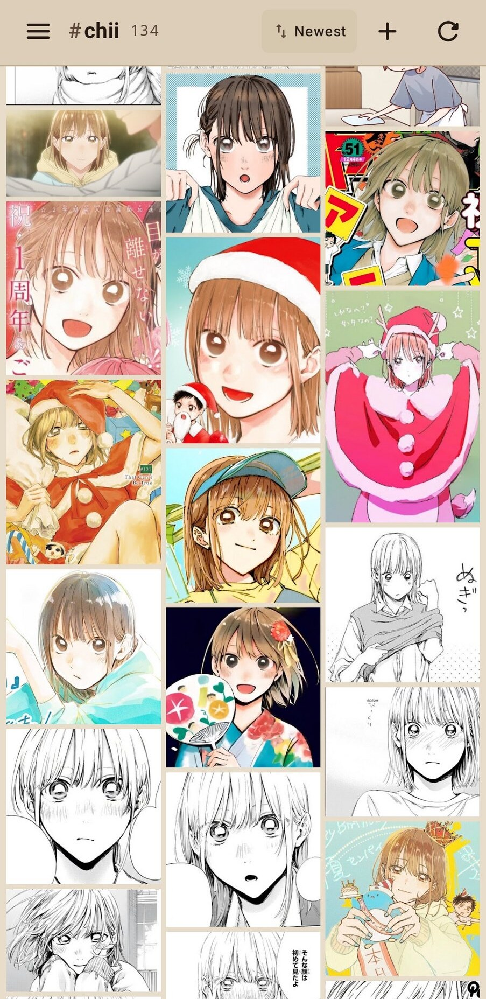
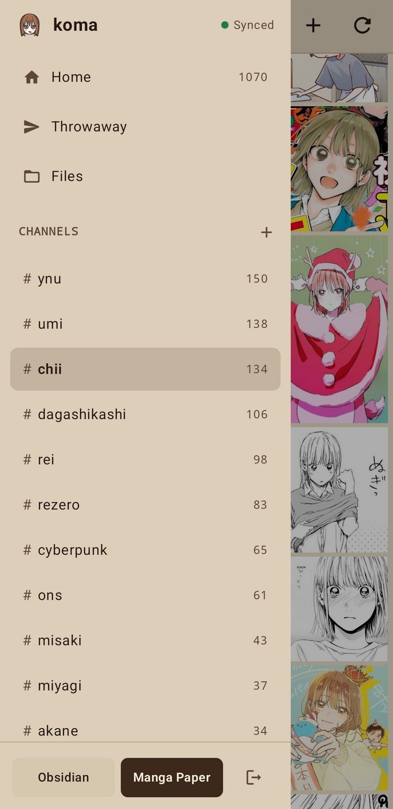

# koma

---

Stop using a private Discord server, WhatsApp self-chat, or email to move files between your PC and your phone. **koma** is a lightweight native file transfer tool and image stash for Windows, Linux, and Android.

Drop a file or paste a screenshot on one device and pick it up on the other. Everything lives in a single `koma` folder in your own Google Drive, with no third-party server and no image compression. Both apps keep a local copy and sync in the background so they open fast and work offline.

LocalSend and PairDrop are faster when both devices are on the same Wi-Fi. koma works when your PC is off or on a different network, and keeps images organized in channels instead of a flat downloads folder.

## What you can do

- **Send files one-way with Throwaway.** Drop any file on PC or phone, grab it on the other device, and it deletes itself after download.
- **Keep recurring files in Files.** A plain shared bucket for documents and anything else you want on both devices.
- **Sort images into channels.** Paste with `Ctrl+V`, upload, or drag and drop into `#channels`. Jump anywhere with `Ctrl+K`, rename or move in the side panel, and open full-size with `Space`.
- **Share to and from your phone.** Select multiple images to share or save to your gallery, or share files and images into koma from any Android app.
- **Pick a look.** Obsidian (dark) and Gofun (light) on both desktop and Android.

## Themes

| Obsidian | Gofun |
| :---: | :---: |
|  |  |

## On your phone

| Obsidian | Obsidian, sidebar | Gofun | Gofun, sidebar |
| :---: | :---: | :---: | :---: |
|  |  |  |  |

## Get it

Download the latest builds from the [Releases](https://github.com/gmdkaio/koma/releases) page.

- **Android:** install the `.apk` (requires Google Play Services).
- **Linux:** extract the archive and run `install.sh` (needs GTK 4.16+ and Libadwaita 1.6+).
- **Windows:** run `koma-setup.exe`.

On first launch, sign in with Google. koma requests only the `drive.file` scope, so it can only access the `koma` folder it creates in your Drive. See [PRIVACY.md](PRIVACY.md) for details.

## Good to know

- **Personal project (`0.1.5`).** Built in Rust (GTK4 + Libadwaita) on desktop and Kotlin (Jetpack Compose) on Android. Expect rough edges.
- **Google sign-in warning.** The bundled OAuth client is unverified, so Google shows a warning screen on first login. You can also build from source with your own Google Cloud Desktop OAuth JSON.
- **Best for everyday files.** Built for images, screenshots, and small-to-medium files rather than multi-gigabyte videos.

## License

[MIT](LICENSE)
