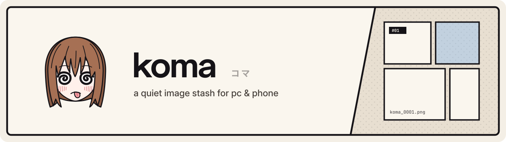

# koma

---

Ever had to use email or Discord to move files between your PC and your phone? Meet **koma**.

Paste an image on your PC with `Ctrl+V`. It shows up on your phone a moment later. Everything is stored in your own Google Drive, so your PC doesn't need to be on.

## What you can do

- **Sort images into channels.** Paste with `Ctrl+V` or drag and drop. Jump anywhere with `Ctrl+K`.
- **Browse them fast.** A clean gallery, a side panel to rename or move things, and a full-size viewer on `Space`.
- **Send any file with Throwaway.** Drop a file on one device, grab it on the other, and it deletes itself after the download.
- **Keep work files in Files.** A plain stash for documents and anything else that isn't an image.
- **Share from your phone.** Select a bunch of images and share or save them. You can also share to koma from any other app.
- **Pick a look.** Obsidian (dark) or Manga Paper (light) on both devices.

## On your phone

  
  
  
  

## Get it

Download the latest build from the [Releases](../../releases) page.

- **Android:** install the `.apk`.
- **Linux:** extract the archive and run `install.sh`.

On first launch, sign in with Google. koma only touches the `koma` folder it creates in your Drive.

> koma is at version 0.1.0 and still growing. Expect rough edges.
